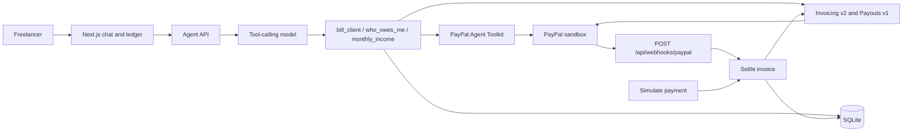
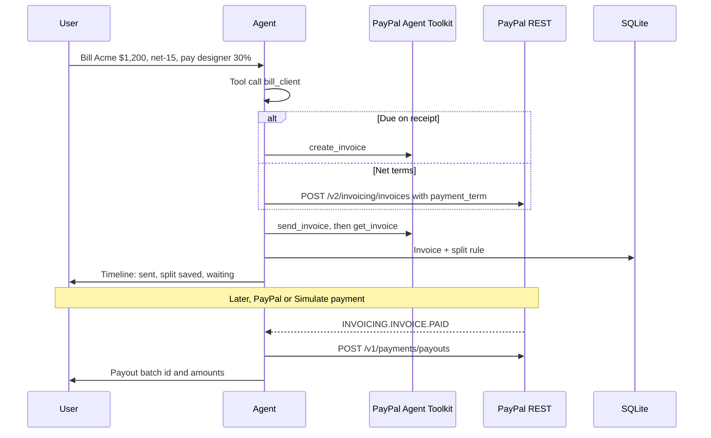

# Splitnote

Splitnote is an agentic invoice and payout assistant for freelancers and small teams, built for the PayPal AI Hackathon. You type a sentence. An LLM turns it into tool calls. PayPal sends the invoice. When the client pays, PayPal pays the collaborator.

> Bill Acme (acme@example.com) $1,200 for the October logo work, net-15, and pay my designer (designer@example.com) 30% when Acme pays.

That instruction creates a real sandbox invoice for **$1,200**, stores a rule that the designer is owed **$360 (30%)**, and waits. On `INVOICING.INVOICE.PAID`, Splitnote submits a PayPal Payouts batch. Every step shows up in the chat timeline.

This is a working prototype: invoices, payouts, and webhook checks call PayPal. It is not a click-through mock.

## Features

- Natural-language billing, receivables ("who still owes me?"), and monthly income.
- PayPal Invoicing v2: create and send, including net terms and a due date.
- Collaborator splits saved locally and released only after the invoice is paid.
- PayPal Payouts v1 batch to one or more collaborator emails.
- Webhook listener for `INVOICING.INVOICE.PAID` with PayPal signature verification.
- **Simulate payment** runs that same paid-event path without a public URL, then makes the real payout call.
- Chat timeline plus an invoices and payouts ledger.
- SQLite storage. OpenAI by default, any OpenAI-compatible API via env.

## Architecture





The Agent Toolkit (`@paypal/agent-toolkit` 1.11, [paypal/agent-toolkit](https://github.com/paypal/agent-toolkit)) is the preferred path for `create_invoice`, `send_invoice`, `get_invoice`, and `record_payment_for_invoice`. Its `create_invoice` schema has no `payment_term`, so **net-15 and the other net terms go through Invoicing v2** directly. Payouts are not in the toolkit, so batches always use `POST /v1/payments/payouts`. The chat still shows which path ran (`toolkit:send_invoice`, `rest:create_invoice`, and so on).

Sandbox mode is explicit. The toolkit defaults `sandbox` to false; Splitnote sets `context.sandbox` from `PAYPAL_ENV`, which itself defaults to `sandbox`.

## AI tools and models

| Piece | What it does |
| --- | --- |
| Vercel AI SDK `generateText` (`ai` 4.3) | Tool-calling loop, up to 4 steps |
| `@ai-sdk/openai` | Default provider. Model is `OPENAI_MODEL`, default `gpt-4o-mini` |
| `OPENAI_BASE_URL` | Swap in any OpenAI-compatible chat API (OpenRouter, Groq, Ollama, …). Compatibility mode turns on when this is set |
| `bill_client` | Creates and sends the invoice, then stores splits |
| `who_owes_me` | Lists sent, unpaid invoices |
| `monthly_income` | Sums payments collected in a month, plus payouts |
| Local parser | Used when `OPENAI_API_KEY` is empty, and as a guardrail if the model skips the tool the sentence clearly asked for |

The model is told not to invent PayPal ids and not to claim a payout was sent unless a tool result says so. Collaborator emails are stored in Splitnote only. They are not written onto the client-facing invoice.

## Setup

Requires Node.js 20 or newer (22 is a good match).

```bash
cp .env.example .env.local
# fill in PayPal sandbox credentials and, for freer wording, OPENAI_API_KEY
npm install
npm test
npm run dev
```

Open [http://localhost:3000](http://localhost:3000).

Without an OpenAI key, the built-in parser still handles the example sentence, "who still owes me?", and "show this month's income". Creating an invoice requires PayPal credentials either way.

## PayPal sandbox credentials

1. Open the [PayPal Developer Dashboard](https://developer.paypal.com/dashboard/) and sign in.
2. Leave the toggle on **Sandbox**.
3. Go to **Apps & Credentials** and choose **Create App**. Name it `Splitnote`. Associate it with the sandbox **business** account.
4. Copy the **Client ID**. Click **Show** under Secret and copy the **Secret**.
5. Put them in `.env.local`:

```bash
PAYPAL_CLIENT_ID=your-sandbox-client-id
PAYPAL_CLIENT_SECRET=your-sandbox-secret
PAYPAL_ENV=sandbox
```

6. Optional, but the invoice looks right when these match the sandbox business account:

```bash
PAYPAL_BUSINESS_NAME=Your Studio
PAYPAL_INVOICER_GIVEN_NAME=Alex
PAYPAL_INVOICER_SURNAME=Rivera
```

Set `PAYPAL_INVOICER_EMAIL` only if it is that business account's email. A mismatched invoicer email is a common reason PayPal rejects the create call.

### Funding payouts

Payouts draw from the sandbox business balance. If a batch returns `INSUFFICIENT_FUNDS`, the chat says so and the invoice card offers **Retry payout**.

1. In the developer dashboard, open **Testing Tools → Sandbox Accounts** (or **Accounts**).
2. Open the business account and note its email and system-generated password.
3. Sign in at [https://www.sandbox.paypal.com](https://www.sandbox.paypal.com) as that business user and add funds to the PayPal balance.
4. Collaborator emails should be other sandbox accounts if you want the payout to land somewhere you can log into. An `example.com` address still produces a payout batch; PayPal will typically leave it unclaimed.

### Real webhooks

Simulate payment is enough for a local demo. For a deployed URL:

1. On the sandbox app, add a webhook.
2. URL: `https://YOUR_DOMAIN/api/webhooks/paypal`
3. Subscribe to **Invoicing → Invoice paid** (`INVOICING.INVOICE.PAID`). Payout batch and payout item events are optional; Splitnote updates batch status when they arrive.
4. Copy the **Webhook ID** into `PAYPAL_WEBHOOK_ID`.

The route posts the payload back to `/v1/notifications/verify-webhook-signature` and accepts it only when `verification_status` is `SUCCESS`. The certificate URL must be `https` on a `paypal.com` host. Unsigned or unverified requests get **401**. A browser `GET` on that path only confirms the listener is up.

`INVOICING.INVOICE.PAID` also fires for partial and pending payments. Splitnote releases collaborator money only when the invoice status is `PAID` or `MARKED_AS_PAID`.

**Refresh PayPal** on the ledger re-reads open invoices and settles any that PayPal already marks paid. That is the other way to finish a demo when you cannot expose a webhook.

## Demo script (about 2 minutes)

1. **0:00** — Open Splitnote. Point at the empty outstanding figure and the example chips.
2. **0:15** — Click **Bill Acme, split 30%**, then **Send**. Read the timeline: invoice id, net-15 due date, designer at $360, waiting on `INVOICING.INVOICE.PAID`. Open **PayPal path** and show `toolkit:` / `rest:` hops. Mention net terms use Invoicing v2 because the toolkit schema has no payment term.
3. **0:50** — On the invoice card, click **Simulate payment**. Explain this stands in for the webhook so the demo does not need a public URL. The payout itself is `POST /v1/payments/payouts`.
4. **1:15** — Read the batch id and status. If PayPal returns insufficient funds, say so and show **Retry payout** — the ledger does not pretend the money moved.
5. **1:35** — Ask **Who still owes me?** The Acme invoice should be gone from outstanding.
6. **1:50** — Ask **Show this month's income**. Collected includes the $1,200; paid out includes the $360 once the batch is accepted.

If a judge pays the sandbox invoice from a personal sandbox account instead of using Simulate payment, the same payout runs from the webhook or from **Refresh PayPal**.

## Tests

```bash
npm test
```

Covers the example sentence (Acme, $1,200, net-15, 30% → $360), two-way splits, receivables and income questions, clarification cases, due-date math, webhook payload shapes, partial-payment holds, payout idempotency, and retry after a failed batch.

## Deploy

### Render

`render.yaml` is included. Create a web service from this repo (build `npm install && npm run build`, start `npm start`) and set the env vars from `.env.example` in the Render dashboard. Do not commit secrets. Set `DEMO_MODE=false` if the URL is public: the button triggers a real sandbox payout.

SQLite lives at `DATABASE_PATH` (default `data/splitnote.db`). Render's filesystem is ephemeral across deploys. For a longer-lived demo, attach a disk and point `DATABASE_PATH` at it.

### Vercel

Import the repo as a Next.js project and set the same env vars. Server routes are Node, not edge. If the project directory is not writable, the database falls back to `/tmp/splitnote.db` and the UI says the ledger is ephemeral.

Point the PayPal webhook at `https://YOUR_APP.vercel.app/api/webhooks/paypal`, or use **Simulate payment** / **Refresh PayPal** during judging.

## Environment

| Variable | Purpose |
| --- | --- |
| `OPENAI_API_KEY` | Model key. Empty = local parser only |
| `OPENAI_MODEL` | Default `gpt-4o-mini` |
| `OPENAI_BASE_URL` | Optional OpenAI-compatible base URL |
| `PAYPAL_CLIENT_ID` | Sandbox app client id |
| `PAYPAL_CLIENT_SECRET` | Sandbox secret (`PAYPAL_SECRET` is also accepted) |
| `PAYPAL_ENV` | `sandbox` (default) or `live` |
| `PAYPAL_WEBHOOK_ID` | Required for real webhook verification |
| `PAYPAL_BUSINESS_NAME`, `PAYPAL_INVOICER_GIVEN_NAME`, `PAYPAL_INVOICER_SURNAME`, `PAYPAL_INVOICER_EMAIL` | Invoicer block |
| `DATABASE_PATH` | SQLite file |
| `DEMO_MODE` | `true` by default. Set `false` to disable Simulate payment |

There is no login. Treat a deployed instance as a private studio tool.

## Project layout

```
src/app/api/chat              agent turn
src/app/api/webhooks/paypal   verified PayPal events
src/app/api/demo/invoice-paid simulated INVOICING.INVOICE.PAID
src/lib/agent.ts              tool-calling loop
src/lib/invoicing.ts          toolkit first, Invoicing v2 when terms require it
src/lib/settlement.ts         payout release
src/lib/parseInstruction.ts   deterministic parser used by tests and as fallback
src/components/Studio.tsx     chat + ledger
```

## License

MIT. See [LICENSE](LICENSE).
